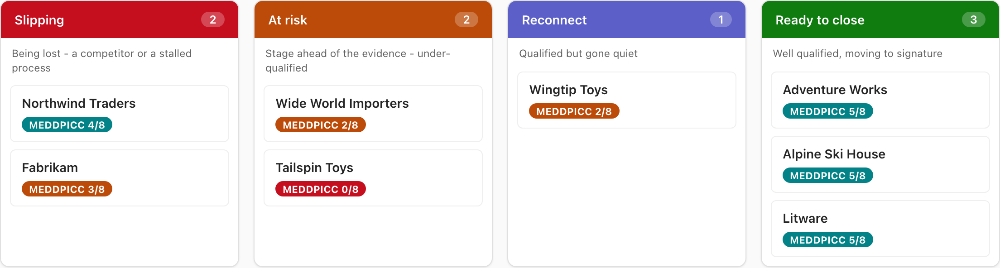
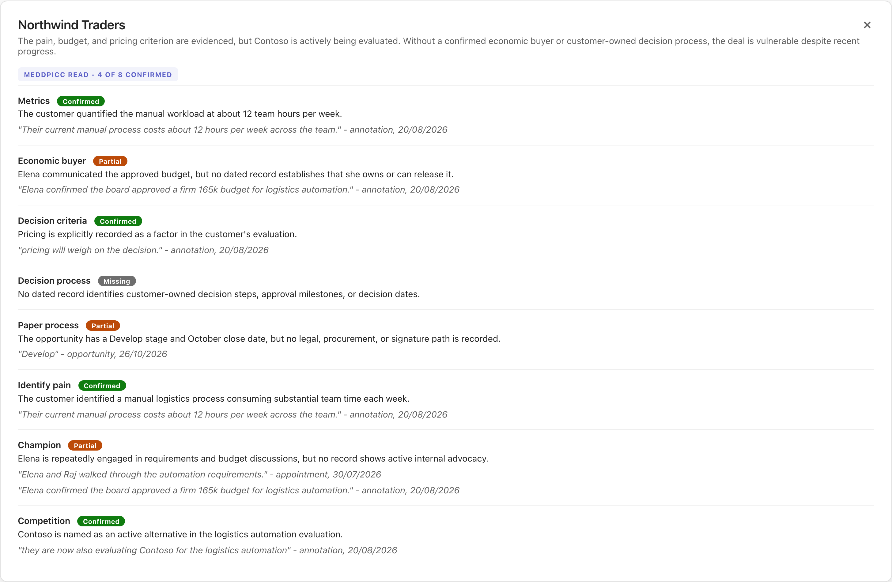
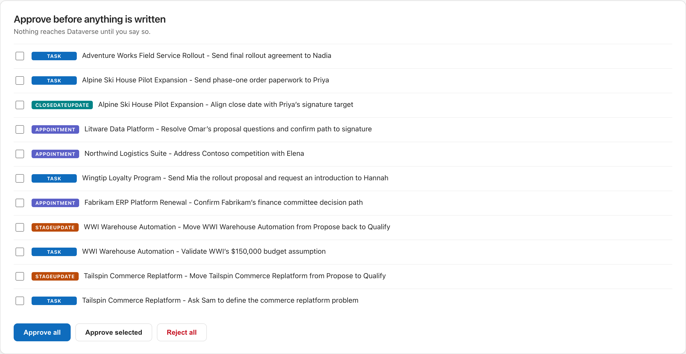
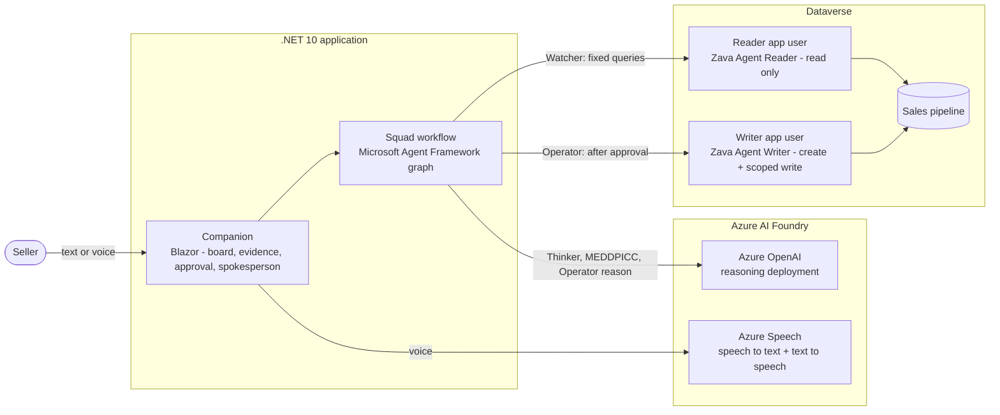
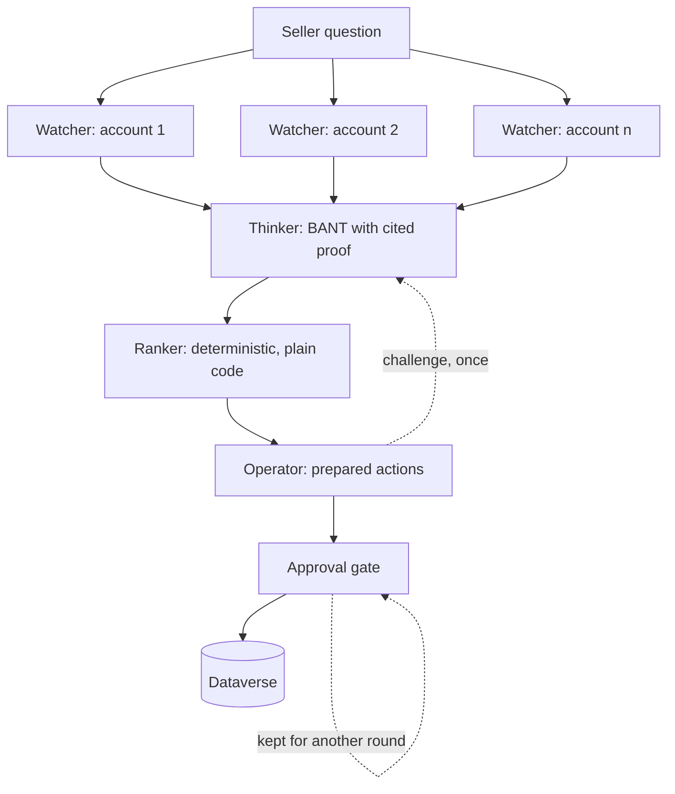
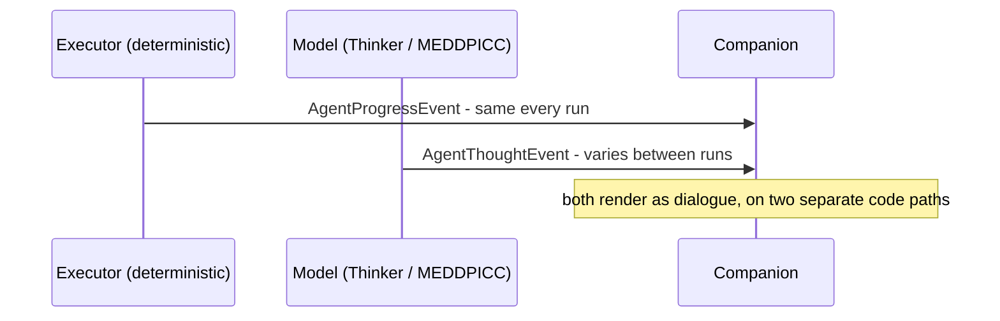

# Dataverse Agent Framework - Sales Intelligence


A multi-agent sales intelligence system on Dataverse, built by hand with [Microsoft Agent Framework](https://learn.microsoft.com/en-us/agent-framework/). It is a reference for how to orchestrate agents as a workflow graph, expose Dataverse as governed tools, and keep a real identity boundary between the agent that reads and the agent that writes.

The moving parts it demonstrates: three agents (a fourth in the AE persona), a superstep barrier, a deterministic ranker, an approval gate before any write, and a reader/writer identity split enforced by Dataverse security roles - all running against Azure AI Foundry (Azure OpenAI for reasoning, Azure Speech for voice).

---

## What it does

A seller asks one question: **what should I focus on this week?**

Three agents answer it. They read the seller's pipeline from Dataverse, assess every open opportunity against BANT with cited evidence, rank them, and prepare actions that are ready to execute. Nothing is written to the CRM without approval, and the approval gate is iterative - approve some now, keep the rest for later.

The seller picks a lens: **SDR** for the fast BANT triage, or **AE** (account executive) for a full MEDDPICC read that places each deal on the board. Then they talk to the squad's spokesperson, by text or by voice, to ask why and to approve - and the records are written under a scoped writer identity, with a direct link to each one.

The seller never opens Dynamics.

---

## Screens

| The board | Evidence, with cited records | Approval before any write |
|---|---|---|
|  |  |  |

---

## Why it exists

Copilot Studio makes agents easy. That is a good thing, and this repo is not an argument against it.

But when a platform runs the orchestration for you, it becomes worth understanding what it is running. This repo builds the same kind of system by hand so the machinery is visible: the workflow graph, the superstep barrier, the approval gate, the identity boundary between agents.

In Copilot Studio you choose your harness. Here you build it.

---

## The three agents

| | Watcher | Thinker | Operator |
|---|---|---|---|
| Role | Retrieves | Judges | Acts |
| Skill | none | `bant-scoring` | `next-best-action` |
| Tools | 5 Dataverse reads, fixed queries | **none** | 4 write tools, approval required |
| Identity | app user, read only | **none** | app user, write scoped |
| Writes | no | no | yes, after approval |

The Thinker having no tools and no identity is the point, not an oversight. No tools means no attack surface. It works only on what the Watcher retrieved. The AE persona adds a fourth agent, the MEDDPICC scorer, built the same way: no tools, no identity, the `meddpicc-scoring` skill.

---

## Architecture

The system end to end. The LLM agents hold no credential: identity lives at the Dataverse client layer - the reader and writer app users - and is enforced by Dataverse security roles, not by agent code.



### Execution flow



The Watcher fans out concurrently. Every branch completes before the Thinker starts - that barrier is the superstep model, and it is why the assessments can be compared against each other rather than judged in isolation.

The Ranker is plain code. Judgement is the model's job; ordering is not.

### Two event types

The squad emits two kinds of event, kept on two separate code paths so demo pacing and reliability stay under control: deterministic progress from the executors, and model output that varies between runs.



---

## Repo layout

```
src/
  Zava.SalesIntelligence.Agents/       agents, instructions, contracts, skills
  Zava.SalesIntelligence.Dataverse/    client, fixed queries, write tools, auth
  Zava.SalesIntelligence.Workflow/     executors, edges, ranker, approval gate, identity middleware, SquadFactory
  Zava.SalesIntelligence.Host/         console workflow runner, prints the graph
  Zava.SalesIntelligence.Companion/    Blazor companion: three screens, spokesperson, voice
samples/
  single-agent/                        one agent, all read tools - the comparison
  magentic/                            same squad, autonomous orchestration
scripts/                               provisioning, seed, demo reset, run helpers
docs/                                  architecture, identity, voice, workflow graph, build brief, TODO
```

---

## Reading guide

| To understand | Start here |
|---|---|
| One agent vs a built harness | `samples/single-agent`, `docs/architecture.md` |
| Autonomous vs hand-built orchestration | `samples/magentic` |
| Exposing Dataverse as tools | `Dataverse/Tools/`, `Agents/skills/` |
| The workflow graph and the superstep barrier | `Workflow/SalesWorkflow.cs`, `Workflow/Executors.cs` |
| The approval gate | `Workflow/SalesWorkflow.cs`, `Companion/Components/Pages/Home.razor` |
| The identity boundary | `Workflow/SquadFactory.cs`, `Workflow/AgentIdentity.cs`, `Dataverse/WriterTools.cs`, `scripts/provision.ps1`, `docs/identity.md` |
| Running it headless | `Host/` |
| The companion and voice | `Companion/`, `docs/voice.md` |

---

## Getting started

**Prerequisites**

- .NET 10 SDK
- A Dataverse environment you can create application users in
- An Azure AI Foundry resource with an Azure OpenAI reasoning deployment (the squad) and Azure Speech (the voice); the samples also use a cheaper deployment
- Azure CLI and Power Platform CLI

**Setup**

```bash
az login

pwsh ./scripts/provision.ps1 -EnvironmentUrl <your-environment-url>   # app registrations, app users, security roles
pwsh ./scripts/seed.ps1      -EnvironmentUrl <your-environment-url>   # demo dataset

# Store the client ids and secrets provision.ps1 prints in scripts/zava.env (git-ignored);
# the run scripts source it. Set ZAVA_SELLER_USER_ID to the account owner. Without secrets,
# identity falls back to your az login.

pwsh ./scripts/reset-demo.ps1 -EnvironmentUrl <your-environment-url>   # before every run: approved writes edit the data

./scripts/run-companion.sh          # the companion at http://localhost:5123
./scripts/run-host.sh               # the console host; `run-host.sh graph` prints the workflow as Mermaid
```

Then open the companion, pick SDR or AE, and click "Run the squad". When the gate opens, ask the
spokesperson (type, or tap the mic and speak): "why is Litware ready?", then "approve the
Litware appointment". The record is written and linked. See `docs/architecture.md` for how it
fits together and `docs/TODO.md` for what is still open.

---

## Notes

The dataset is fictional. Zava is Microsoft's standard fictional company.

Security roles are intentionally minimal. The reader role cannot write and the writer role cannot read beyond what it needs. If you adapt this, keep that separation - it is doing real work.

---

## Further reading

- [Microsoft Agent Framework documentation](https://learn.microsoft.com/en-us/agent-framework/)
- [Microsoft Entra Agent ID for Dataverse](https://www.microsoft.com/en-us/power-platform/blog/2026/08/06/microsoft-entra-agent-id-for-dataverse/)
- [Build Agent 365-ready adaptive intelligence with Work IQ and Dataverse](https://www.microsoft.com/en-us/power-platform/blog/2026/01/27/build-adaptive-intelligence/)
- [Building an agent using Microsoft 365 Agents SDK and Microsoft Agent Framework](https://www.dynamicsforcrm.com/building-an-agent-using-microsoft-365-agents-sdk-and-microsoft-agent-framework/)

---

## Author

Allan De Castro - [blog.allandecastro.com](https://blog.allandecastro.com)
Microsoft MVP, Business Applications - FastTrack Recognized Solution Architect

## Licence

MIT
