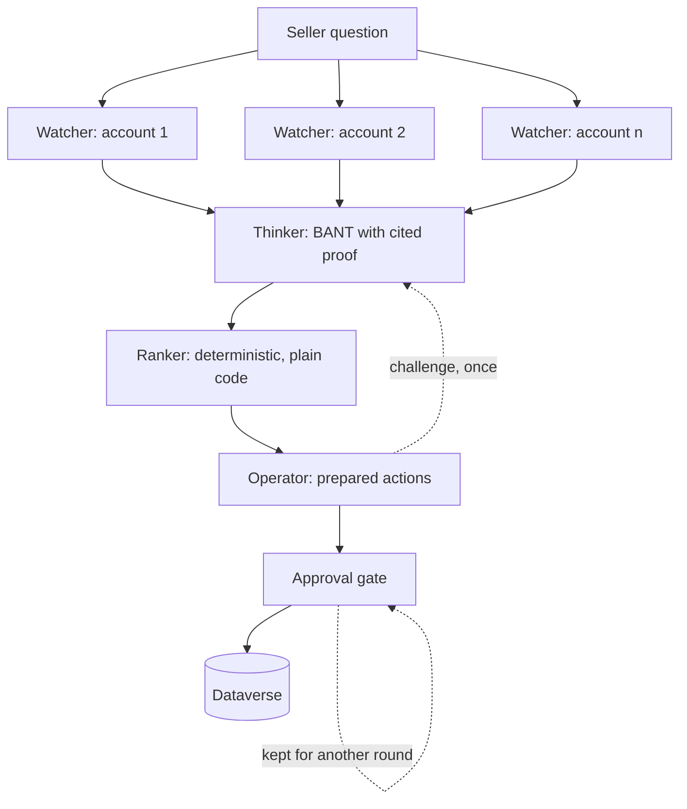

# Dataverse Agent Framework - Sales Intelligence

A multi-agent sales intelligence system built on Dataverse with [Microsoft Agent Framework](https://learn.microsoft.com/en-us/agent-framework/).

Demo repo for the session *AI Agents Meet Dataverse: Building Intelligent Automations with Microsoft Agent Framework* - Power Platform Community Conference 2026, Las Vegas.

---

## What it does

A seller asks one question: **what should I focus on this week?**

Three agents answer it. They read the seller's pipeline from Dataverse, assess every open opportunity against BANT with cited evidence, rank them, and prepare actions that are ready to execute. Nothing is written to the CRM without approval, and the approval gate is iterative - approve some now, keep the rest for later.

The seller picks a lens: **SDR** for the fast BANT triage, or **AE** (account executive) for a full MEDDPICC read that places each deal on the board. Then they talk to the squad's spokesperson, by text or by voice, to ask why and to approve - and the records are written under a scoped writer identity, with a direct link to each one.

The seller never opens Dynamics.

---

## Why it exists

Copilot Studio makes agents easy. That is a good thing, and this repo is not an argument against it.

But when a platform runs the orchestration for you, it becomes worth understanding what it is running. This repo builds the same kind of system by hand so the machinery is visible: the workflow graph, the superstep barrier, the approval gate, the identity boundary between agents.

In Copilot Studio you choose your harness. Here you build it.

---

## The three agents

| | Watcher | Thinker | Operator |
|---|---|---|---|
| Role | Retrieves | Judges | Acts |
| Skill | none | `bant-scoring` | `next-best-action` |
| Tools | 5 Dataverse reads, fixed queries | **none** | 4 write tools, approval required |
| Identity | app user, read only | **none** | app user, write scoped |
| Writes | no | no | yes, after approval |

The Thinker having no tools and no identity is the point, not an oversight. No tools means no attack surface. It works only on what the Watcher retrieved. The AE persona adds a fourth agent, the MEDDPICC scorer, built the same way: no tools, no identity, the `meddpicc-scoring` skill.

---

## Architecture



The Watcher fans out concurrently. Every branch completes before the Thinker starts - that barrier is the superstep model, and it is why the assessments can be compared against each other rather than judged in isolation.

The Ranker is plain code. Judgement is the model's job; ordering is not.

---

## Repo layout

```
src/
  Zava.SalesIntelligence.Agents/       agents, instructions, contracts, skills
  Zava.SalesIntelligence.Dataverse/    client, fixed queries, write tools, auth
  Zava.SalesIntelligence.Workflow/     executors, edges, ranker, approval gate, identity middleware, SquadFactory
  Zava.SalesIntelligence.Host/         console workflow runner, prints the graph
  Zava.SalesIntelligence.Companion/    Blazor companion: three screens, spokesperson, voice
samples/
  single-agent/                        one agent, all read tools - the comparison
  magentic/                            same squad, autonomous orchestration
scripts/                               provisioning, seed, demo reset, run helpers
docs/                                  architecture, identity, voice, workflow graph, build brief, TODO
```

---

## Session map

| Session block | Where to look |
|---|---|
| What a harness is | slides |
| Agent Framework intro | `samples/single-agent`, `docs/architecture.md` |
| Orchestration patterns | `samples/magentic`, `Workflow/` |
| Exposing Dataverse as tools | `Dataverse/Tools/`, `Agents/skills/` |
| The squad in action | `Workflow/`, `Companion/` |
| Identity boundaries | `Workflow/SquadFactory.cs`, `Workflow/AgentIdentity.cs`, `Dataverse/WriterTools.cs`, `scripts/provision.ps1`, `docs/identity.md` |
| Headless and protocols | `Host/`, `Companion/` |

---

## Getting started

**Prerequisites**

- .NET 10 SDK
- A Dataverse environment you can create application users in
- An Azure AI Foundry resource with an Azure OpenAI reasoning deployment (the squad) and Azure Speech (the voice); the samples also use a cheaper deployment
- Azure CLI and Power Platform CLI

**Setup**

```bash
az login

pwsh ./scripts/provision.ps1 -EnvironmentUrl <your-environment-url>   # app registrations, app users, security roles
pwsh ./scripts/seed.ps1      -EnvironmentUrl <your-environment-url>   # demo dataset

# Store the client ids and secrets provision.ps1 prints in scripts/zava.env (git-ignored);
# the run scripts source it. Set ZAVA_SELLER_USER_ID to the account owner. Without secrets,
# identity falls back to your az login.

pwsh ./scripts/reset-demo.ps1 -EnvironmentUrl <your-environment-url>   # before every run: approved writes edit the data

./scripts/run-companion.sh          # the companion at http://localhost:5123
./scripts/run-host.sh               # the console host; `run-host.sh graph` prints the workflow as Mermaid
```

Then open the companion, pick SDR or AE, and click "Run the squad". When the gate opens, ask the
spokesperson (type, or tap the mic and speak): "why is Litware ready?", then "approve the
Litware appointment". The record is written and linked. See `docs/architecture.md` for how it
fits together and `docs/TODO.md` for what is still open.

---

## Notes

The dataset is fictional. Zava is Microsoft's standard fictional company.

Security roles are intentionally minimal. The reader role cannot write and the writer role cannot read beyond what it needs. If you adapt this, keep that separation - it is doing real work.

---

## Further reading

- [Microsoft Agent Framework documentation](https://learn.microsoft.com/en-us/agent-framework/)
- [Microsoft Entra Agent ID for Dataverse](https://www.microsoft.com/en-us/power-platform/blog/2026/08/06/microsoft-entra-agent-id-for-dataverse/)
- [Build Agent 365-ready adaptive intelligence with Work IQ and Dataverse](https://www.microsoft.com/en-us/power-platform/blog/2026/01/27/build-adaptive-intelligence/)
- [Building an agent using Microsoft 365 Agents SDK and Microsoft Agent Framework](https://www.dynamicsforcrm.com/building-an-agent-using-microsoft-365-agents-sdk-and-microsoft-agent-framework/)

---

## Author

Allan De Castro - [blog.allandecastro.com](https://blog.allandecastro.com)
Microsoft MVP, Business Applications - FastTrack Recognized Solution Architect

## Licence

MIT
