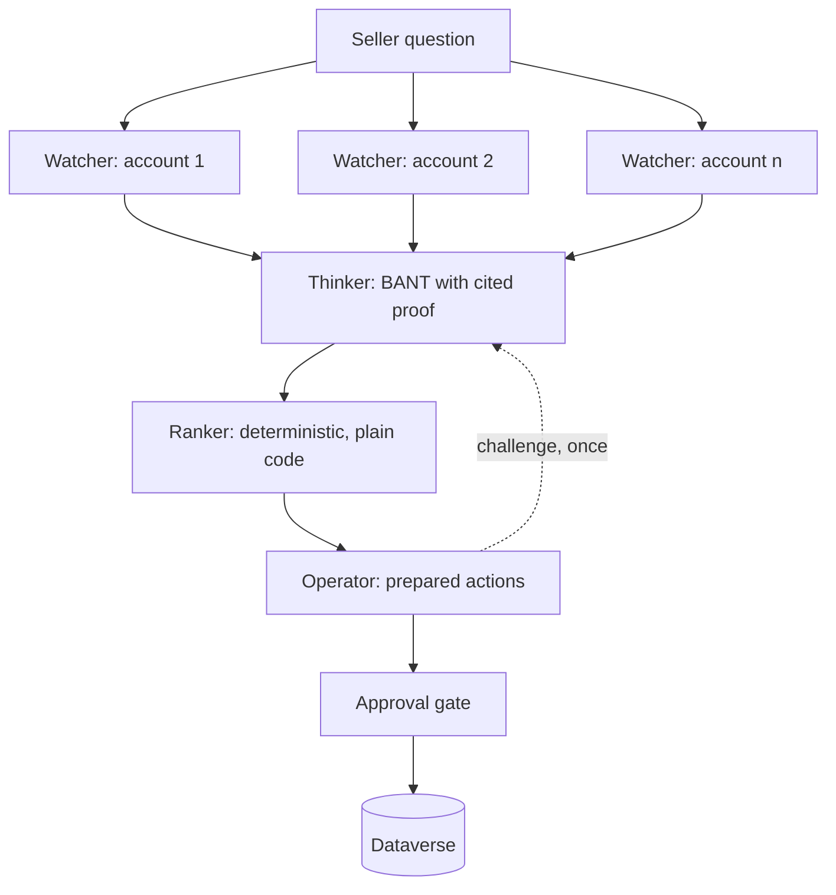

# Dataverse Agent Framework - Sales Intelligence

A multi-agent sales intelligence system built on Dataverse with [Microsoft Agent Framework](https://learn.microsoft.com/en-us/agent-framework/).

Demo repo for the session *AI Agents Meet Dataverse: Building Intelligent Automations with Microsoft Agent Framework* - Power Platform Community Conference 2026, Las Vegas.

---

## What it does

A seller asks one question: **what should I focus on this week?**

Three agents answer it. They read the pipeline from Dataverse, assess every open opportunity against BANT with cited evidence, rank them, and prepare actions that are ready to execute. Nothing is written to the CRM without approval.

The seller never opens Dynamics.

---

## Why it exists

Copilot Studio makes agents easy. That is a good thing, and this repo is not an argument against it.

But when a platform runs the orchestration for you, it becomes worth understanding what it is running. This repo builds the same kind of system by hand so the machinery is visible: the workflow graph, the superstep barrier, the approval gate, the identity boundary between agents.

In Copilot Studio you choose your harness. Here you build it.

---

## The three agents

| | Watcher | Thinker | Operator |
|---|---|---|---|
| Role | Retrieves | Judges | Acts |
| Skill | none | `bant-scoring` | `next-best-action` |
| Tools | 5 Dataverse reads, fixed queries | **none** | 4 write tools, approval required |
| Identity | app user, read only | **none** | app user, write scoped |
| Writes | no | no | yes, after approval |

The Thinker having no tools and no identity is the point, not an oversight. No tools means no attack surface. It works only on what the Watcher retrieved.

---

## Architecture



The Watcher fans out concurrently. Every branch completes before the Thinker starts - that barrier is the superstep model, and it is why the assessments can be compared against each other rather than judged in isolation.

The Ranker is plain code. Judgement is the model's job; ordering is not.

---

## Repo layout

```
src/
  Zava.SalesIntelligence.Agents/       agents, instructions, contracts, skills
  Zava.SalesIntelligence.Dataverse/    client, tools, auth
  Zava.SalesIntelligence.Workflow/     executors, edges, ranker, approval
  Zava.SalesIntelligence.Host/         ASP.NET Core, AG-UI, DevUI
  Zava.SalesIntelligence.Companion/    Blazor client
  Zava.SalesIntelligence.Voice/        Blazor voice shell
samples/
  single-agent/                        one agent, all tools - the comparison
  magentic/                            same squad, autonomous orchestration
scripts/                               provisioning and dataset seed
docs/                                  build brief, diagrams
```

---

## Session map

| Session block | Where to look |
|---|---|
| What a harness is | slides |
| Agent Framework intro | `samples/single-agent`, `docs/architecture.md` |
| Orchestration patterns | `samples/magentic`, `Workflow/` |
| Exposing Dataverse as tools | `Dataverse/Tools/`, `Agents/skills/` |
| The squad in action | `Workflow/`, `Companion/` |
| Identity boundaries | `Dataverse/Auth/`, `Workflow/Middleware/` |
| Headless and protocols | `Host/`, `Companion/`, `Voice/` |

---

## Getting started

**Prerequisites**

- .NET 10 SDK
- A Dataverse environment you can create application users in
- An Azure OpenAI resource with two deployments
- Azure CLI and Power Platform CLI

**Setup**

```bash
az login
pac auth create --environment <your-environment-url>

./scripts/provision.ps1     # app registrations, app users, security roles
./scripts/seed.ps1          # demo dataset

dotnet user-secrets set ...  # see scripts/provision.ps1 output

dotnet run --project src/Zava.SalesIntelligence.Host
```

Then open the companion, or `/devui` to watch the workflow graph.

---

## Notes

The dataset is fictional. Zava is Microsoft's standard fictional company.

Security roles are intentionally minimal. The reader role cannot write and the writer role cannot read beyond what it needs. If you adapt this, keep that separation - it is doing real work.

---

## Further reading

- [Microsoft Agent Framework documentation](https://learn.microsoft.com/en-us/agent-framework/)
- [Microsoft Entra Agent ID for Dataverse](https://www.microsoft.com/en-us/power-platform/blog/2026/08/06/microsoft-entra-agent-id-for-dataverse/)
- [Build Agent 365-ready adaptive intelligence with Work IQ and Dataverse](https://www.microsoft.com/en-us/power-platform/blog/2026/01/27/build-adaptive-intelligence/)
- [Building an agent using Microsoft 365 Agents SDK and Microsoft Agent Framework](https://www.dynamicsforcrm.com/building-an-agent-using-microsoft-365-agents-sdk-and-microsoft-agent-framework/)

---

## Author

Allan De Castro - [blog.allandecastro.com](https://blog.allandecastro.com)
Microsoft MVP, Business Applications - FastTrack Recognized Solution Architect

## Licence

MIT
