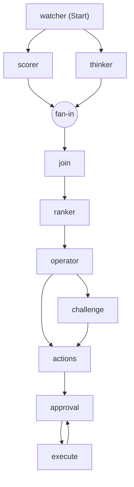

# Workflow graph

The actual Microsoft Agent Framework workflow, generated from the built graph, not drawn
by hand. Regenerate it any time with:

```bash
./scripts/run-host.sh graph
```

That prints the graph as Mermaid (via `workflow.ToMermaidString()`) and exits without
running it. No DevUI or Aspire required. The graph below is the AE persona (set
`ZAVA_PERSONA=ae`); the SDR persona is the same without the Scorer branch and the fan-in.



Watcher retrieves the seller's account contexts, then fans out. In the AE persona the same
context goes to two branches that run concurrently: the Thinker judges each account against
BANT, and the Scorer scores each against MEDDPICC (`AddFanOutEdge`). A fan-in barrier
(`AddFanInBarrierEdge`) holds both results until each branch has finished, and the Join merges
every scorecard onto its account's BANT judgment before the Ranker sees anything. The SDR
persona has no Scorer: the Thinker feeds the Ranker directly, a single linear head.

From the Ranker on, both personas are identical. The Ranker orders the opportunities in plain
code, and the Operator decides whether to challenge. If any action would rest on a Missing axis
it routes to the Challenge, where the Thinker re-examines the evidence once; otherwise it goes
straight to actions. Both paths converge on the actions stage, which prepares the proposals.
The `approval` node is the `RequestPort`: the run pauses there until the seller decides.
`execute` writes the approved actions under the writer identity, and the `execute --> approval`
edge is the iterative gate - a partial approval sends the remaining proposals back to the port
for another round, so approving some actions never discards the rest. Each arrow is a superstep
barrier; the fan-in is the barrier made explicit.
