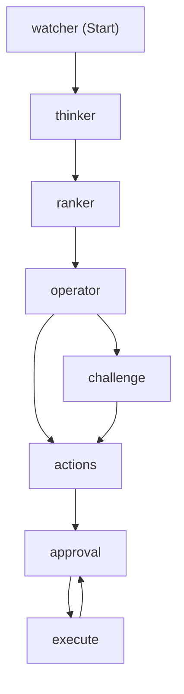

# Workflow graph

The actual Microsoft Agent Framework workflow, generated from the built graph, not drawn
by hand. Regenerate it any time with:

```bash
./scripts/run-host.sh graph
```

That prints the graph as Mermaid (via `workflow.ToMermaidString()`) and exits without
running it. No DevUI or Aspire required.



Watcher retrieves the seller's account contexts, the Thinker judges each against BANT, the
Ranker orders them in plain code, and the Operator decides whether to challenge. If any
action would rest on a Missing axis it routes to the Challenge, where the Thinker re-examines
the evidence once; otherwise it goes straight to actions. Both paths converge on the actions
stage, which prepares the proposals (and, in the AE persona, scores each opportunity against
MEDDPICC). The `approval` node is the `RequestPort`: the run pauses there until the seller
decides. `execute` writes the approved actions under the writer identity, and the
`execute --> approval` edge is the iterative gate - a partial approval sends the remaining
proposals back to the port for another round, so approving some actions never discards the
rest. Each arrow is a superstep barrier.
