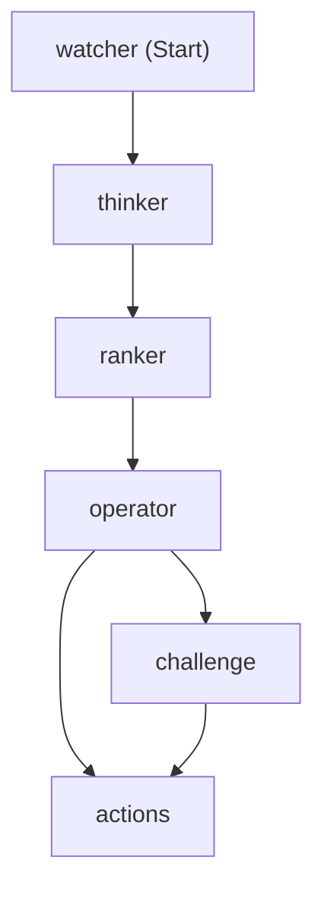

# Workflow graph

The actual Microsoft Agent Framework workflow, generated from the built graph, not drawn
by hand. Regenerate it any time with:

```bash
dotnet run --project src/Zava.SalesIntelligence.Host graph
```

That prints the graph as Mermaid (via `workflow.ToMermaidString()`) and exits without
running it. No DevUI or Aspire required.



Watcher retrieves every account context, the Thinker judges each against BANT, the Ranker
orders them in plain code, and the Operator decides whether to challenge. If any action
would rest on a Missing axis it routes to the Challenge, where the Thinker re-examines the
evidence once; otherwise it goes straight to actions. Both paths converge on the actions
stage, which prepares the brief. Each arrow is a superstep barrier.
